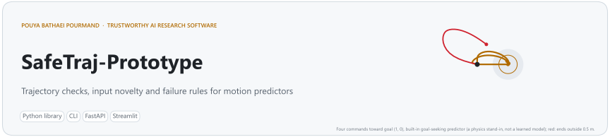
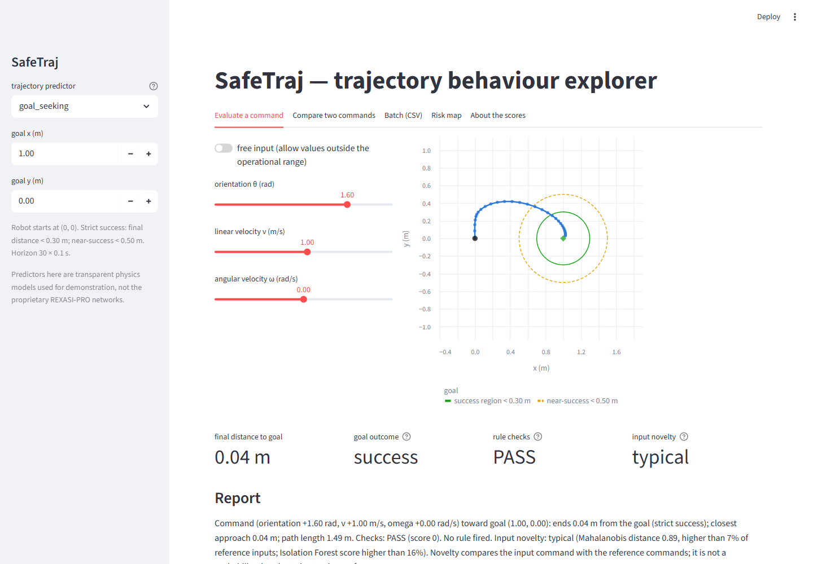
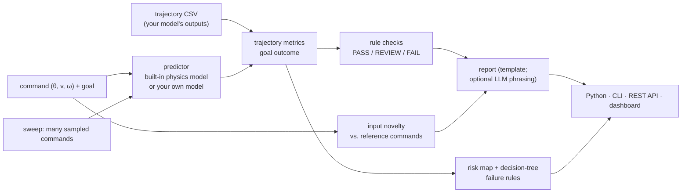
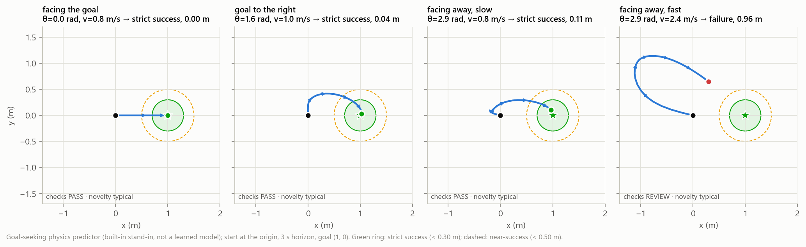
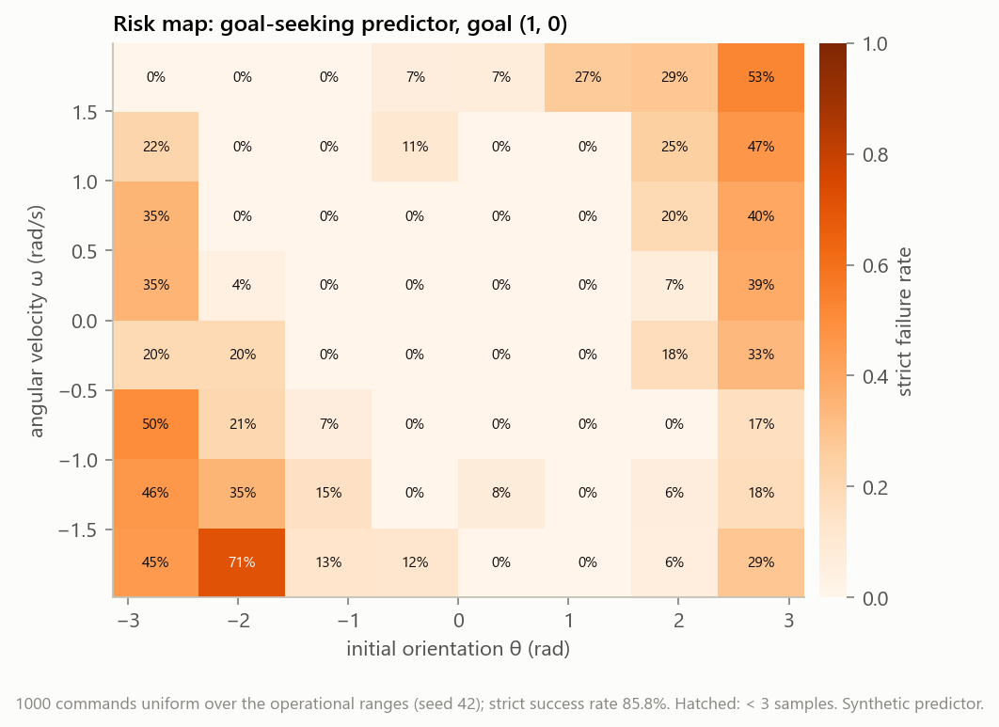
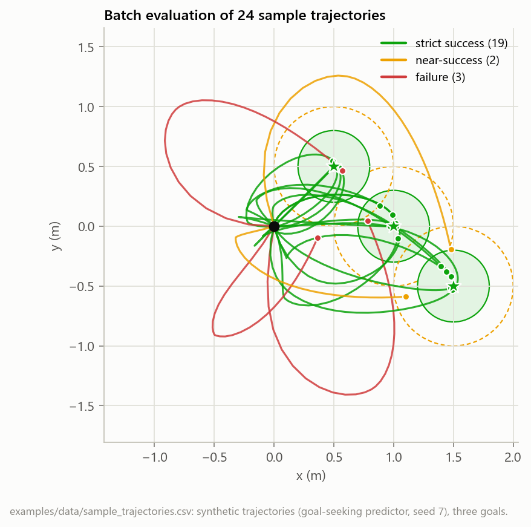
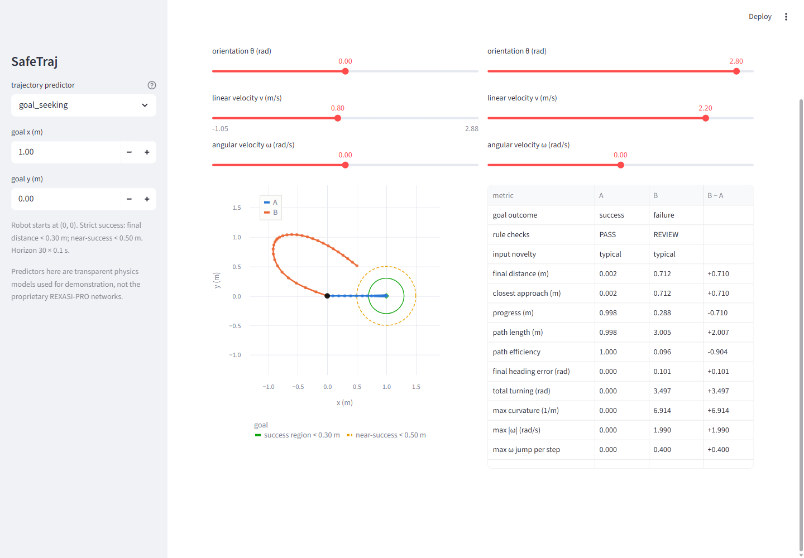
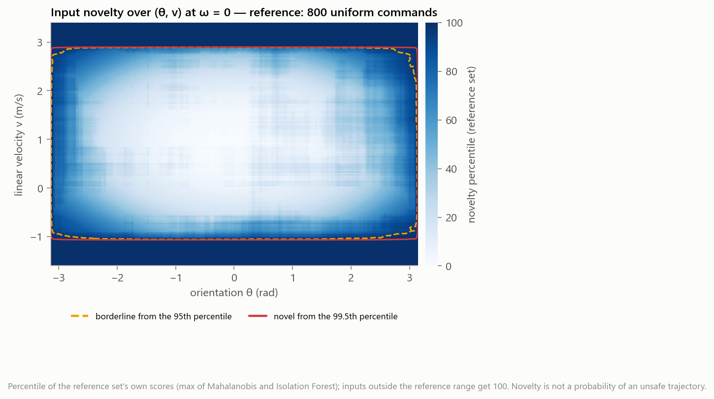

<picture>
  <source media="(prefers-color-scheme: dark)" srcset="docs/assets/banner-dark.svg">
  
</picture>

<p align="center">
  <a href="https://github.com/pouyapd/SafeTraj-Prototype/actions/workflows/tests.yml"></a>
  
  
  <a href="LICENSE"></a>
  
</p>

<p align="center">
  <a href="#what-it-does">What it does</a> ·
  <a href="#example-outputs">Examples</a> ·
  <a href="#quick-start">Quick start</a> ·
  <a href="#rest-api">REST API</a> ·
  <a href="#deployment-status">Deployment status</a> ·
  <a href="#limitations">Limitations</a>
</p>

A learned trajectory predictor maps a command and a goal to a predicted path. Average accuracy hides *where* it fails. SafeTraj-Prototype packages a failure-analysis workflow so it can be applied to **any** predictor:

- measure each predicted trajectory against its goal;
- check it with fixed, explicit rules;
- score how unusual the input is;
- map failure rates over many sampled commands;
- summarise them as decision-tree rules.

One implementation sits behind a Python library, a CLI, a REST API and a Streamlit dashboard, so all four give the same numbers (tested).

<p align="center">
  
</p>
<p align="center"><sub>The dashboard running locally (<code>streamlit run dashboard/app.py</code>). A command (orientation θ, linear velocity v, angular velocity ω) is turned into a 3 s trajectory, measured against the goal, checked by fixed rules and compared with reference inputs.</sub></p>

**Author:** Pouya Bathaei Pourmand, MSc Computer Engineering, University of Genoa. Written alongside my MSc thesis, which evaluated pretrained neural trajectory predictors for a smart wheelchair within the EU Horizon Europe project [REXASI-PRO](https://rexasi-pro.spindoxlabs.com/) (thesis code and results: [SafeTraj-Experiments](https://github.com/pouyapd/SafeTraj-Experiments)). This repository is a personal open-source tool; it contains no project models or data.

## What it does

| Capability | What you get | Where |
|---|---|---|
| **Trajectory metrics** | final / closest distance to goal, progress, path length and efficiency, heading error, turning, curvature, ω jumps; goal outcome with the thesis thresholds (success < 0.30 m, near-success < 0.50 m) | `safetraj/metrics.py` |
| **Rule checks** | five fixed-threshold rules, each reporting its measured value and threshold; label PASS / REVIEW / FAIL | `safetraj/rules.py` |
| **Input novelty** | Mahalanobis distance and Isolation Forest, expressed as percentiles of a reference set; label typical / borderline / novel; per-feature attribution | `safetraj/ood.py` |
| **Batch evaluation** | every trajectory in a CSV → `results.csv`, `results.json`, Markdown report with figures | `python -m safetraj batch` |
| **Comparison** | two commands toward the same goal, metric differences | `compare` command, `/compare`, dashboard tab |
| **Risk map + failure rules** | sample commands, map strict-failure rates over (θ, ω), fit a depth-4 tree, report cross-validated accuracy vs. the majority baseline and readable IF-THEN failure rules | `safetraj/analysis.py`, `sweep` command, dashboard tab |
| **Reports** | deterministic text report; optional local LLM (Ollama) phrasing that is used only if it passes a consistency check, otherwise the template is used | `safetraj/report.py`, `safetraj/llm.py` |
| **Interfaces** | Python API, CLI, FastAPI service, Streamlit dashboard; all call `SafeTrajEvaluator` | `api/`, `dashboard/` |



## Example outputs

All examples use the built-in **goal-seeking predictor**: a transparent physics model (a unicycle that starts with the commanded speeds and steers to the goal with limited acceleration and turn rate). It stands in for a learned model so the tools can be tried without proprietary networks; the patterns it produces come from its equations, not from data.

**Same goal, four commands.** Facing away from the goal at high speed, the robot overshoots and cannot turn back within the 3 s horizon.

<p align="center"></p>

**A typical input can still fail.** The trajectory above that fails is *typical* relative to the reference commands. Novelty and trajectory outcome answer different questions, which is why they are reported separately (full response under [REST API](#rest-api)).

**Risk map and failure rules over 1,000 sampled commands** (`python examples/make_figures.py`):

<p align="center"></p>

```text
IF orientation > 1.76 and v_lin > 1.69 and v_rot > -0.68 THEN failure (47 samples, 91% failures)
IF orientation <= -1.88 and v_lin > 1.90 and v_rot <= 0.79 THEN failure (46 samples, 96% failures)
IF orientation <= -1.88 and 1.69 < v_lin <= 1.90 and v_rot <= 0.79 THEN failure (12 samples, 58% failures)

train accuracy 0.941; 5-fold CV 0.921 +/- 0.014; majority baseline 0.858
```

The tree's cross-validated accuracy (0.92) is compared with always predicting the majority outcome (0.86), so the rules' added value is visible rather than assumed.

**Batch evaluation** of the bundled sample (`examples/data/sample_trajectories.csv`, 24 synthetic trajectories toward three goals): 19 strict successes, 2 near-successes, 3 failures; checks 19 PASS, 5 REVIEW.

<p align="center">
  
  
</p>

**What the novelty score measures.** With a uniform reference set, inputs near the edges of the operational box are rarer and score higher; anything outside the box scores 100.

<p align="center"></p>

### What the scores mean, and what they do not

| Output | Meaning | Not a claim of |
|---|---|---|
| goal outcome | where the predicted trajectory ends relative to the goal (thesis thresholds) | real-world task success |
| rule checks | which of five hand-chosen heuristics fired, with values and thresholds | safety; PASS only means no rule fired |
| input novelty | how unusual the input is compared with the reference commands (percentiles of the reference set's own scores) | a probability of an unsafe trajectory; *typical* ≠ safe and *novel* ≠ unsafe |
| decision-tree rules | a compact description of where the sampled failures are | a guarantee for unseen inputs; see the CV accuracy and baseline |
| LLM text (optional) | a rephrasing of the rule result, accepted only if consistent | an independent judgement |

The default reference set is 800 synthetic commands spread uniformly over the operational ranges of the thesis models (θ ∈ [−π, π] rad, v ∈ [−1.05, 2.88] m/s, ω ∈ [−1.99, 1.99] rad/s). For a real model, pass its training inputs: `SafeTrajEvaluator(reference_data=X_train)`.

## Quick start

```bash
git clone https://github.com/pouyapd/SafeTraj-Prototype.git
cd SafeTraj-Prototype
pip install -r requirements.txt        # Python 3.10+
```

```bash
# guided walk-through: single command, comparison, batch, sweep (about 30 s)
python examples/end_to_end.py

# one command (θ = 2.9 rad, v = 2.4 m/s, ω = 0) toward the default goal (1, 0)
python -m safetraj evaluate --orientation 2.9 --v 2.4 --omega 0 --plot trajectory.png

# compare two commands
python -m safetraj compare --a 0 2.4 0 --b 2.9 2.4 0

# your own model's trajectories (CSV: traj_id,t,x,y,theta,v,omega,goal_x,goal_y)
python -m safetraj batch --input examples/data/sample_trajectories.csv --out results/batch

# risk map and failure rules over 400 sampled commands and three goals
python -m safetraj sweep --n 400 --out results/sweep

# dashboard and API
streamlit run dashboard/app.py
uvicorn api.main:app --reload          # docs at http://127.0.0.1:8000/docs
```

Outputs go to `results/`, `examples/output/` and `trajectory.png`, which are ignored by Git.

Python:

```python
from safetraj import SafeTrajEvaluator

ev = SafeTrajEvaluator()                       # goal-seeking predictor, synthetic reference set
res = ev.evaluate([2.9, 2.4, 0.0], goal=(1.0, 0.0))
res["metrics"]["d_final"], res["checks"]["label"], res["novelty"]["label"]   # (0.959..., 'REVIEW', 'typical')

# analyse your own predictor: any object with predict(command, goal) -> safetraj.Trajectory
ev = SafeTrajEvaluator(predictor=my_predictor, reference_data=X_train)
```

## REST API

Version 2.0.0, started locally with `uvicorn api.main:app`. Interactive documentation is at `/docs`.

| Method | Path | Purpose |
|---|---|---|
| GET | `/` | service name, version, list of endpoints |
| GET | `/health` | `{"status": "ok"}` |
| GET | `/config` | operational ranges, goal and rule thresholds, novelty percentiles, reference data, predictors |
| POST | `/evaluate` | one command: `orientation`, `v_lin`, `v_rot`; optional `goal_x`, `goal_y`, `predictor` (`goal_seeking` or `constant_command`), `include_trajectory` |
| POST | `/evaluate/trajectory` | a trajectory you supply: `points` (each `t, x, y, theta, v, omega`), `goal_x`, `goal_y`, optional `command` for the novelty score |
| POST | `/evaluate/batch` | up to 500 commands as `[orientation, v_lin, v_rot]` lists |
| POST | `/compare` | two commands toward the same goal, with `difference_b_minus_a` |
| POST | `/report` | deterministic text report with the checks and novelty |

```bash
curl -s -X POST http://127.0.0.1:8000/evaluate \
     -H "Content-Type: application/json" \
     -d '{"orientation": 2.9, "v_lin": 2.4, "v_rot": 0.0}'
```

Response (abridged; values from the running service):

```json
{
  "goal": [1.0, 0.0],
  "predictor": "goal_seeking",
  "metrics": {"d_final": 0.9585, "progress": 0.0415, "path_length": 3.2335,
              "outcome_strict": "failure", "outcome_soft": "failure"},
  "checks": {"label": "REVIEW", "score": 4, "triggered": ["far_from_goal_end", "low_progress"]},
  "novelty": {"label": "typical", "score": 0.894, "mahalanobis": 2.054,
              "mahalanobis_percentile": 78.375, "isolation_forest_percentile": 89.375,
              "outside_reference_range": false}
}
```

Each entry of `checks.rules` lists the rule's measured value, threshold and message, e.g. `"final distance to goal 0.96 m (threshold 0.30 m)"`. Invalid input returns HTTP 422 with the reason:

```bash
curl -s -X POST http://127.0.0.1:8000/evaluate -H "Content-Type: application/json" \
     -d '{"orientation": 9.0, "v_lin": 2.4, "v_rot": 0.0}'
# 422: "Input should be less than or equal to 3.141592653589793" (loc: body.orientation)
```

Out-of-range commands, non-finite numbers, trajectories with fewer than two points or non-increasing time are rejected the same way.

## Deployment status

| Component | Status | How it was checked |
|---|---|---|
| Local library, CLI, API, dashboard (v2.0.0) | **verified** | 46 tests, locally and in CI, exercise every route; the API was also started with `uvicorn` and `/`, `/health`, `/config` and `/evaluate` were called; the dashboard runs headless in a test |
| Hosted API on Render ([`/docs`](https://safetraj-api.onrender.com/docs)) | **still version 1.0.0** | On 2026-10-12, `GET /` reported `"version": "1.0.0"`; `/health` and `/config` return 404. The free instance serves whatever was last deployed and needs about a minute to wake up. It is not updated until a redeploy from `main` is confirmed. |
| Hosted Streamlit demo ([link](https://safetraj-prototype-auhavyacsp7udguqdsezhm.streamlit.app/)) | **not publicly viewable; unverified** | On 2026-10-12 an anonymous request was redirected to Streamlit's sign-in page (`share.streamlit.io/-/auth/app`), so the app currently needs a Streamlit login to view. Whether it works after signing in was not checked. (On 2026-10-11 the same network got HTTP 403 for every `*.streamlit.app` address, an access restriction rather than an app failure.) |
| Optional LLM phrasing with Ollama | **not tested live** | Tested only with mocked responses and with an unavailable server (the template is then used). |

To test the Ollama path:

1. Install [Ollama](https://ollama.com) and start it (`ollama serve` or the desktop app); it listens on `localhost:11434`.
2. Pull the model: `ollama pull mistral`.
3. Run `python -m safetraj evaluate --orientation 2.9 --v 2.4 --omega 0 --llm mistral:latest`.

The note after the report says whether the model's text passed the consistency check or the template was used. If an HTTP proxy is configured, `localhost` must be excluded from it (`NO_PROXY=localhost`).

## Tests

```bash
pip install -r requirements-dev.txt
pytest                                   # 46 tests
```

The tests cover:

- trajectory validation;
- every metric and rule threshold;
- the unicycle predictor geometry;
- novelty scoring, including a regression test for the version 1 Mahalanobis bug;
- sweeps and decision-tree rules;
- the LLM fallback and consistency check (with a mocked LLM);
- all API routes and validation errors;
- the CLI;
- agreement between API and Python results;
- a headless run of the dashboard.

GitHub Actions runs them on Python 3.10 and 3.12.

## Limitations

- The built-in predictors are physics stand-ins. Conclusions about a real model require running its own predictions through the toolkit.
- The default novelty reference set is synthetic and uniform; with it, novelty mostly measures closeness to the edges of the operational box.
- Rule thresholds are hand-chosen heuristics; they have not been validated against real collisions or user studies.
- The optional LLM path has not been run against a live Ollama server, and no real model output is included here.
- Nothing in this repository has been tested on a robot or wheelchair.

## Repository map

```text
SafeTraj-Prototype/
├── safetraj/            # library: trajectory, metrics, rules, ood, predictor, evaluator,
│                        #          analysis, report, llm, plotting, cli
├── api/main.py          # FastAPI service
├── dashboard/           # Streamlit app (app.py) and Altair charts (charts.py)
├── examples/            # end_to_end.py, demo_basic.py, make_figures.py, data/sample_trajectories.csv
├── trajsafe_llm/        # version 1 command kept as a wrapper (see its README)
├── docs/                # figures/ (README figures and screenshots), assets/ (banner)
└── tests/
```

<details>
<summary><b>Changes in version 2</b></summary>

- **Fixed:** the Mahalanobis score subtracted the reference mean twice (`EmpiricalCovariance.mahalanobis` already centres its input), so the "most typical" input was placed at twice the mean velocity. A regression test now checks the score against the textbook formula.
- **Fixed:** the kinematic predictor drew a straight line for any angular velocity (only the heading rotated). It now follows exact unicycle motion.
- **Changed:** "risk score / in-distribution & low-risk" labels became separate, explicitly named outputs (rule checks; input novelty with percentile thresholds). The version 1 `|x| / Σ|x|` "feature importance" is replaced by a score-based attribution; the old function remains, marked deprecated.
- **Added:** trajectory metrics, batch CSV evaluation and export, comparison, sweeps with risk maps and failure rules, template reports with optional LLM phrasing and fallback, input validation, the CLI, new API endpoints, an interactive dashboard and 46 tests.
- **Removed:** the version 1 screenshots in `assets/`, which showed the old risk score.

</details>

## Related projects

- [SafeTraj-Experiments](https://github.com/pouyapd/SafeTraj-Experiments): MSc thesis, black-box evaluation of five pretrained neural trajectory predictors (risk maps, decision-tree rules).
- [trajectory-failure-analysis](https://github.com/pouyapd/trajectory-failure-analysis): the same failure-analysis approach on real pedestrian trajectories (ETH dataset).
- [SafeNav-RL](https://github.com/pouyapd/SafeNav-RL): reinforcement learning with a control-barrier-function safety filter (simulation).

## License

MIT, see [LICENSE](LICENSE).
