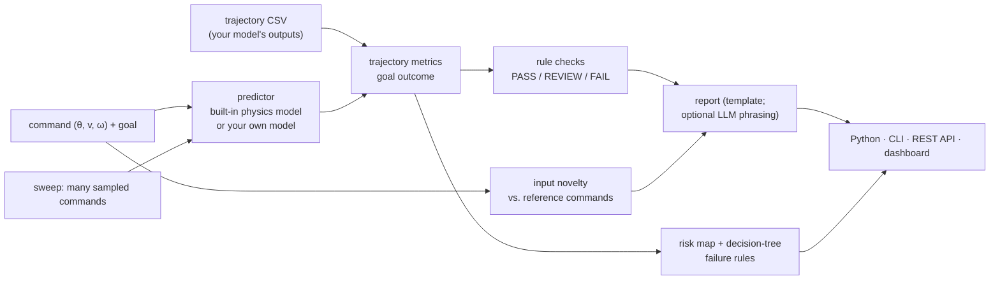

# SafeTraj-Prototype

**A small toolkit for analysing how trajectory predictors behave: trajectory checks, input-novelty scores, risk maps and decision-tree failure rules — one implementation behind a Python library, a CLI, a REST API and a Streamlit dashboard.**

[](https://www.python.org/)
[](LICENSE)
[](https://safetraj-prototype-auhavyacsp7udguqdsezhm.streamlit.app/)
[](https://safetraj-api.onrender.com/docs)

<p align="center">
  
</p>
<p align="center"><em>The dashboard running locally (<code>streamlit run dashboard/app.py</code>). A command (orientation θ, linear velocity v, angular velocity ω) is turned into a 3 s trajectory, measured against the goal, checked by fixed rules and compared with reference inputs.</em></p>

**Author:** Pouya Bathaei Pourmand · MSc Computer Engineering (AI), University of Genoa.
Written alongside my MSc thesis, which evaluated pretrained neural trajectory predictors for a smart wheelchair within the EU Horizon Europe project [REXASI-PRO](https://rexasi-pro.spindoxlabs.com/) (thesis code and results: [SafeTraj-Experiments](https://github.com/pouyapd/SafeTraj-Experiments)). This repository is a personal open-source tool; it contains no project models or data.

---

## Why

A learned trajectory predictor maps a command and a goal to a predicted path. Average accuracy hides *where* it fails. The thesis answered "where" by sampling the command space, labelling each predicted trajectory against the goal, mapping failure rates and fitting shallow decision trees. This toolkit packages that workflow so it can be applied to **any** predictor, and adds per-trajectory checks and an input-novelty score for single cases.

## What it does

| Capability | What you get | Where |
|---|---|---|
| **Trajectory metrics** | final / closest distance to goal, progress, path length and efficiency, heading error, turning, curvature, ω jumps; goal outcome with the thesis thresholds (success < 0.30 m, near-success < 0.50 m) | `safetraj/metrics.py` |
| **Rule checks** | five fixed-threshold rules, each reporting its measured value and threshold; label PASS / REVIEW / FAIL | `safetraj/rules.py` |
| **Input novelty** | Mahalanobis distance and Isolation Forest, expressed as percentiles of a reference set; label typical / borderline / novel; per-feature attribution | `safetraj/ood.py` |
| **Batch evaluation** | every trajectory in a CSV → `results.csv`, `results.json`, Markdown report with figures | `python -m safetraj batch` |
| **Comparison** | two commands toward the same goal, metric differences | `compare` command, `/compare`, dashboard tab |
| **Risk map + failure rules** | sample commands, map strict-failure rates over (θ, ω), fit a depth-4 tree, report cross-validated accuracy vs. the majority baseline and readable IF-THEN failure rules | `safetraj/analysis.py`, `sweep` command, dashboard tab |
| **Reports** | deterministic text report; optional local LLM (Ollama) phrasing that is used only if it passes a consistency check, otherwise the template is used | `safetraj/report.py`, `safetraj/llm.py` |
| **Interfaces** | Python API, CLI, FastAPI service, Streamlit dashboard — all call `SafeTrajEvaluator`, so results agree (tested) | `api/`, `dashboard/` |

## Architecture



## Example outputs

All examples below use the built-in **goal-seeking predictor**: a transparent physics model (a unicycle that starts with the commanded speeds and steers to the goal with limited acceleration and turn rate). It stands in for a learned model so the tools can be tried without proprietary networks; the patterns it produces come from its equations, not from data.

**Same goal, four commands.** Facing away from the goal at high speed, the robot overshoots and cannot turn back within the 3 s horizon.

<p align="center"></p>

**A typical input can still fail.** The last command above, through the REST API (`POST /evaluate`, abbreviated):

```json
{
  "input": {"orientation": 2.9, "v_lin": 2.4, "v_rot": 0.0},
  "metrics": {"d_final": 0.959, "progress": 0.041, "path_length": 3.233, "outcome_soft": "failure"},
  "checks": {"label": "REVIEW", "score": 4, "triggered": ["far_from_goal_end", "low_progress"]},
  "novelty": {"label": "typical", "score": 0.894, "mahalanobis": 2.054, "mahalanobis_percentile": 78.4}
}
```

The trajectory fails, yet the input is *typical* relative to the reference commands. Novelty and trajectory outcome answer different questions, which is why they are reported separately.

**Risk map and failure rules over 1,000 sampled commands** (`python examples/make_figures.py`):

<p align="center"></p>

```text
IF orientation > 1.76 and v_lin > 1.69 and v_rot > -0.68 THEN failure (47 samples, 91% failures)
IF orientation <= -1.88 and v_lin > 1.90 and v_rot <= 0.79 THEN failure (46 samples, 96% failures)
IF orientation <= -1.88 and 1.69 < v_lin <= 1.90 and v_rot <= 0.79 THEN failure (12 samples, 58% failures)

train accuracy 0.941; 5-fold CV 0.921 +/- 0.014; majority baseline 0.858
```

The tree's cross-validated accuracy (0.92) is compared with always predicting the majority outcome (0.86), so the rules' added value is visible rather than assumed.

**Batch evaluation** of the bundled sample (`examples/data/sample_trajectories.csv`, 24 synthetic trajectories toward three goals): 19 strict successes, 2 near-successes, 3 failures; checks 19 PASS, 5 REVIEW.

<p align="center">
  
  
</p>

**What the novelty score measures.** With a uniform reference set, inputs near the edges of the operational box are rarer and score higher; anything outside the box scores 100.

<p align="center"></p>

## What the scores mean — and what they do not

| Output | Meaning | Not a claim of |
|---|---|---|
| goal outcome | where the predicted trajectory ends relative to the goal (thesis thresholds) | real-world task success |
| rule checks | which of five hand-chosen heuristics fired, with values and thresholds | safety; PASS only means no rule fired |
| input novelty | how unusual the input is compared with the reference commands (percentiles of the reference set's own scores) | a probability of an unsafe trajectory; *typical* ≠ safe and *novel* ≠ unsafe |
| decision-tree rules | a compact description of where the sampled failures are | a guarantee for unseen inputs; see the CV accuracy and baseline |
| LLM text (optional) | a rephrasing of the rule result, accepted only if consistent | an independent judgement |

The default reference set is 800 synthetic commands spread uniformly over the operational ranges of the thesis models (θ ∈ [−π, π] rad, v ∈ [−1.05, 2.88] m/s, ω ∈ [−1.99, 1.99] rad/s). For a real model, pass its training inputs: `SafeTrajEvaluator(reference_data=X_train)`.

## Installation

```bash
git clone https://github.com/pouyapd/SafeTraj-Prototype.git
cd SafeTraj-Prototype
pip install -r requirements.txt        # Python 3.10+
```

## Quick start

```bash
# guided walk-through: single command, comparison, batch, sweep (about 30 s)
python examples/end_to_end.py

# one command (θ = 2.9 rad, v = 2.4 m/s, ω = 0) toward the default goal (1, 0)
python -m safetraj evaluate --orientation 2.9 --v 2.4 --omega 0 --plot trajectory.png

# compare two commands
python -m safetraj compare --a 0 2.4 0 --b 2.9 2.4 0

# your own model's trajectories (CSV: traj_id,t,x,y,theta,v,omega,goal_x,goal_y)
python -m safetraj batch --input examples/data/sample_trajectories.csv --out results/batch

# risk map and failure rules over 400 sampled commands and three goals
python -m safetraj sweep --n 400 --out results/sweep

# dashboard and API
streamlit run dashboard/app.py
uvicorn api.main:app --reload          # docs at http://127.0.0.1:8000/docs
```

Python:

```python
from safetraj import SafeTrajEvaluator

ev = SafeTrajEvaluator()                       # goal-seeking predictor, synthetic reference set
res = ev.evaluate([2.9, 2.4, 0.0], goal=(1.0, 0.0))
res["metrics"]["d_final"], res["checks"]["label"], res["novelty"]["label"]   # (0.959..., 'REVIEW', 'typical')

# analyse your own predictor: any object with predict(command, goal) -> safetraj.Trajectory
ev = SafeTrajEvaluator(predictor=my_predictor, reference_data=X_train)
```

### REST API

| Method | Path | Purpose |
|---|---|---|
| GET | `/health`, `/config` | status; thresholds, ranges and reference data in use |
| POST | `/evaluate` | one command (`orientation`, `v_lin`, `v_rot`, optional `goal_x`, `goal_y`, `predictor`, `include_trajectory`) |
| POST | `/evaluate/trajectory` | a trajectory you supply (`points`, `goal_x`, `goal_y`, optional `command`) |
| POST | `/evaluate/batch` | up to 500 commands |
| POST | `/compare` | two commands, same goal |
| POST | `/report` | deterministic text report |

Inputs are validated: out-of-range commands, non-finite numbers, trajectories with fewer than two points or non-increasing time return HTTP 422 with a message. The hosted instance (Render free tier) needs about a minute to wake up and serves whatever version was last deployed from `main`.

## Tests

```bash
pip install -r requirements-dev.txt
pytest
```

46 tests cover trajectory validation, every metric and rule threshold, the unicycle predictor geometry, novelty scoring (including a regression test for the version 1 Mahalanobis bug), sweeps and decision-tree rules, the LLM fallback and consistency check (with a mocked LLM), all API routes and validation errors, the CLI, agreement between API and Python results, and a headless run of the dashboard. A GitHub Actions workflow (`.github/workflows/tests.yml`) is set up to run them on Python 3.10 and 3.12.

## Project structure

```text
SafeTraj-Prototype/
├── safetraj/            # library: trajectory, metrics, rules, ood, predictor, evaluator,
│                        #          analysis, report, llm, plotting, cli
├── api/main.py          # FastAPI service
├── dashboard/           # Streamlit app (app.py) and Altair charts (charts.py)
├── examples/            # end_to_end.py, demo_basic.py, make_figures.py, data/sample_trajectories.csv
├── trajsafe_llm/        # version 1 command kept as a wrapper (see its README)
├── docs/figures/        # README figures and screenshots
└── tests/
```

## Changes in version 2

- **Fixed:** the Mahalanobis score subtracted the reference mean twice (`EmpiricalCovariance.mahalanobis` already centres its input), so the "most typical" input was placed at twice the mean velocity. A regression test now checks the score against the textbook formula.
- **Fixed:** the kinematic predictor drew a straight line for any angular velocity (only the heading rotated). It now follows exact unicycle motion.
- **Changed:** "risk score / in-distribution & low-risk" labels became separate, explicitly named outputs (rule checks; input novelty with percentile thresholds). The version 1 `|x| / Σ|x|` "feature importance" is replaced by a score-based attribution; the old function remains, marked deprecated.
- **Added:** trajectory metrics, batch CSV evaluation and export, comparison, sweeps with risk maps and failure rules, template reports with optional LLM phrasing and fallback, input validation, the CLI, new API endpoints, an interactive dashboard and 46 tests.

## Limitations

- The built-in predictors are physics stand-ins. Conclusions about a real model require running its own predictions through the toolkit.
- The default novelty reference set is synthetic and uniform; with it, novelty mostly measures closeness to the edges of the operational box.
- Rule thresholds are hand-chosen heuristics; they have not been validated against real collisions or user studies.
- The optional LLM path was tested with mocked responses and with an unavailable server (fallback); no real model output is included here.
- Nothing in this repository has been tested on a robot or wheelchair.

## Related projects

- [SafeTraj-Experiments](https://github.com/pouyapd/SafeTraj-Experiments) — MSc thesis: black-box evaluation of five pretrained neural trajectory predictors (risk maps, decision-tree rules).
- [trajectory-failure-analysis](https://github.com/pouyapd/trajectory-failure-analysis) — the same failure-analysis approach on real pedestrian trajectories (ETH dataset).
- [SafeNav-RL](https://github.com/pouyapd/SafeNav-RL) — reinforcement-learning navigation with a control-barrier-function safety filter (simulation).

## License

MIT — see [LICENSE](LICENSE).
